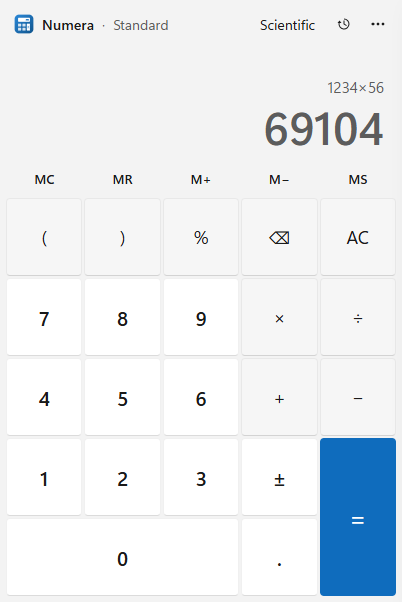
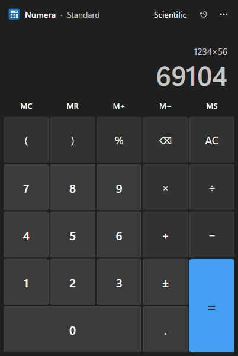
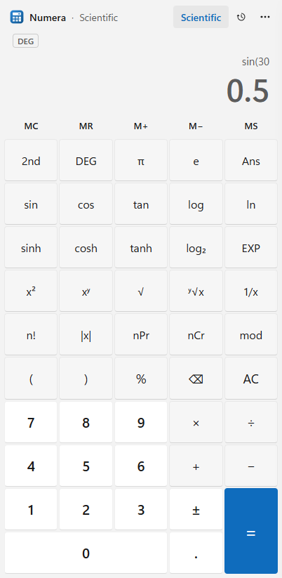

<p align="center">
  
</p>

<h1 align="center">Numera Calculator</h1>

<p align="center">
  A precise standard and scientific calculator for Windows, with light and dark themes.<br>
  Built with Electron and vanilla JavaScript: a hand-written maths parser, no <code>eval</code>, zero runtime dependencies.
</p>

<p align="center">
  <a href="https://github.com/Pavi-Ashok/Numera-Calculator/releases/latest"><b>⬇ Download for Windows</b></a>
  ·
  <a href="ARCHITECTURE.md">Architecture</a>
</p>

<p align="center">
  
  
  
</p>

## Try it

1. Download **`Numera-Calculator-Portable-1.0.0.exe`** (runs without installing) or **`Numera-Calculator-Setup-1.0.0.exe`** (installer) from the [latest release](https://github.com/Pavi-Ashok/Numera-Calculator/releases/latest).
2. Double-click it. Windows SmartScreen may say *"Windows protected your PC"* because the app isn't code-signed: click **More info → Run anyway**.

Requires Windows 10 or 11 (64-bit).

## Features

- **Standard and Scientific modes.** The Scientific button (or F2) reveals 25 more keys and grows the window.
- **Scientific functions:** trig and inverse trig in DEG/RAD/GRAD, hyperbolic functions, log/ln/log₂, powers and roots, n! (Gamma for non-integers), nPr, nCr, mod, EXP, π, e, Ans, Rand.
- **Live preview** while typing, **history** drawer (saved between sessions), **memory** keys (MC/MR/M+/M−/MS).
- **Full keyboard support,** e.g. `s` sin, `r` √, Enter for =, Esc to clear, Ctrl+C to copy the result.
- **Light, Dark or System theme,** with the Windows title bar following the choice.
- **Accessible:** screen-reader labels on every key, keyboard focus rings, WCAG AA contrast in both themes, reduced-motion and Windows High Contrast support.

## Engineering highlights

- **Custom maths engine:** a tokenizer and recursive-descent parser with correct precedence, right-associative powers, implicit multiplication (`2π`, `3(4+1)`) and auto-closing brackets.
- **Numerical care:** `0.1+0.2−0.3` gives `0`, `sin(180°)` gives `0`, `200+10%` gives `220`, `(−8)^(1/3)` gives `−2`, and huge angles stay accurate.
- **Secure Electron setup:** context isolation, sandboxed renderer, strict Content Security Policy, and a three-function IPC bridge.
- **Tested:** about 190 engine assertions (`node:test`) and 76 end-to-end scenarios that drive the real app window.

Full write-up: **[ARCHITECTURE.md](ARCHITECTURE.md)**.

## Run from source

Requires [Node.js](https://nodejs.org) 18 or newer.

```bash
npm install
npm start            # run the app
npm test             # engine unit tests
npm run test:ui      # end-to-end UI tests
npm run dist         # build the Windows installer and portable exe into dist/
```

## Tech stack

Electron 44 · HTML/CSS/JavaScript (no framework) · node:test · electron-builder (NSIS + portable)
